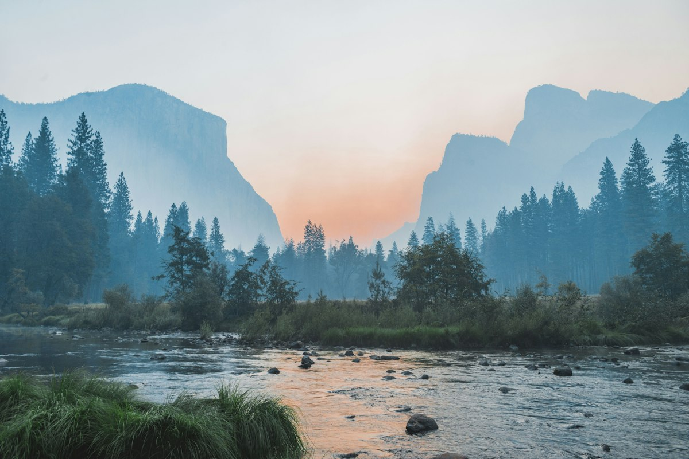

# 🚀 Editor Markdown — Soporte Completo de Imágenes y Formato Visual

> [!TIP]
> **Nueva Característica en v2.4:** Soporte nativo para incrustación de **imágenes locales**. Podés referenciar cualquier imagen en tu disco (rutas relativas o absolutas); al abrir o exportar tu documento a PDF o HTML, se incrustan automáticamente sin enlaces rotos ni depender de internet.

---

## 🖼️ 1. Galería de Imágenes Locales en Alta Resolución

Podés insertar imágenes desde el explorador con el botón de la barra o escribiendo la ruta relativa: ``.

### 🏞️ Fotografía Diurna (Ruta Local Relativa)
Carga instantánea de fotos y recursos gráficos almacenados en tu computadora:


*Figura 1: Parque Nacional Yosemite — Tonos cálidos y reflejos nítidos cargados desde `./assets/paisaje.jpg`.*

---

### 🌌 Fotografía Nocturna (Ruta Local Relativa)
Comprobá cómo destacan las fotografías locales con alto contraste sobre el tema oscuro:


*Figura 2: Vía Láctea sobre cordillera nevada cargada desde `./assets/montanias-noche.jpg`.*

---

## ⚡ 2. Características Interactivas Destacadas

| Funcionalidad | Sintaxis | Estado en Vivo |
| :--- | :--- | :---: |
| **Resaltado Ámbar** | `==texto importante==` | ==Lectura descansada== |
| **Alertas GitHub** | `> [!NOTE]`, `> [!WARNING]` | 🛡️ Activo |
| **Exportación Nativa** | PDF Vectorial / HTML | 📄 1 Clic |
| **Imágenes Locales** | `./assets/imagen.png` | 🖼️ Incrustadas |

### 📋 Lista de Tareas Interactiva (Probalo tildando acá)
- [x] Inserción de imágenes locales mediante diálogo nativo
- [x] Soporte para formatos PNG, JPG, WebP, SVG y GIF
- [x] Incrustación Base64 automática para exportar a PDF y HTML
- [ ] Sacar capturas para la ficha de la Microsoft Store :camera:

---

## 💻 3. Bloque de Código con Copiado Rápido

```rust
// Backend de alto rendimiento en Rust (Tauri V2)
pub fn incrustar_imagenes_locales(html: &str, ruta_base: Option<&str>) -> String {
    // Convierte imágenes relativas en Data URLs Base64 al vuelo
    RE_IMG.replace_all(html, |caps: &regex::Captures| {
        resolver_e_incrustar(&caps[2], ruta_base)
    }).to_string()
}
```

> [!NOTE]
> Podés colapsar el editor haciendo clic en el icono del **ojo** en la barra superior para ver este documento en **Modo Lector a Pantalla Completa**.
  